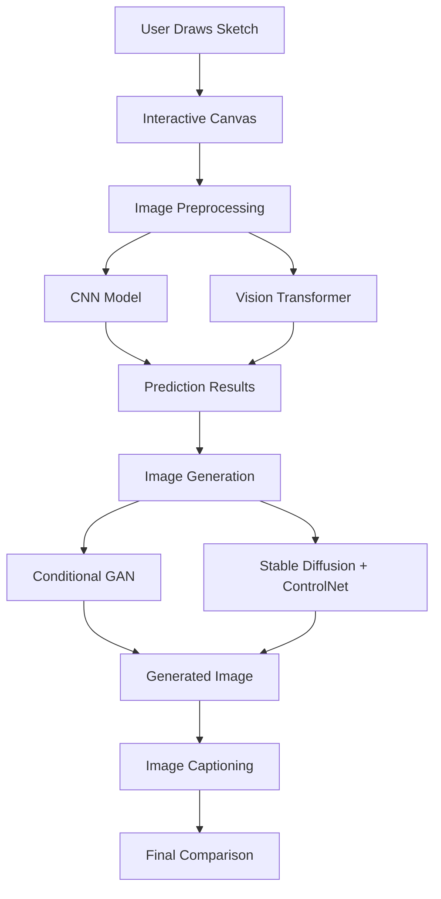

# 🎨 Sketch2Reality – AI-Powered Sketch to Image Generation

<p align="center">
  <b>Turn simple sketches into AI-generated visual representations.</b>
</p>

Sketch2Reality is an AI-powered application that transforms hand-drawn sketches into meaningful visual representations. It combines deep learning-based image recognition and generative AI to understand user drawings and generate corresponding images.

Users can draw directly on an interactive canvas, recognize their sketches using CNN and Vision Transformer models, and generate images using Conditional GAN or Stable Diffusion with ControlNet.

## ✨ Key Features

- 🎨 **Interactive Drawing Canvas** – Draw using mouse or touch with pen, eraser, undo, and clear functionality.
- 🧠 **CNN-Based Recognition** – Recognizes hand-drawn objects using a Convolutional Neural Network.
- 🔍 **Vision Transformer (ViT)** – Uses transformer-based image recognition for sketch classification.
- 🖼️ **AI Image Generation** – Converts sketches into visual representations using Conditional GAN or Stable Diffusion with ControlNet.
- 📝 **Image Captioning** – Generates descriptions using BLIP or template-based captions.
- 📊 **Side-by-Side Comparison** – Compares the original sketch, predicted label, generated image, caption, and sketch-match score.

## 🏗️ System Architecture



## 🛠️ Technology Stack

| Category | Technologies |
|---|---|
| Programming Language | Python |
| Deep Learning | PyTorch |
| Computer Vision | CNN, Vision Transformer |
| Generative AI | Conditional GAN, Stable Diffusion |
| Image Generation | ControlNet |
| Image Captioning | BLIP |
| Backend | FastAPI |
| Frontend | HTML, CSS, JavaScript |
| Dataset | Google Quick, Draw Dataset |
| API Server | Uvicorn |

## 🧠 Deep Learning Models

### 1. Convolutional Neural Network (CNN)
- Learns visual patterns from hand-drawn sketches.
- Extracts features such as edges, shapes, and patterns.
- Performs sketch classification.

### 2. Vision Transformer (ViT)
- Uses attention mechanisms to understand image features.
- Provides an alternative approach to sketch recognition.
- Allows comparison with CNN-based predictions.

### 3. Conditional GAN
- Generates images based on sketch categories.
- Provides a CPU-friendly image generation alternative.
- Learns category-conditioned image generation.

### 4. Stable Diffusion + ControlNet
- Generates more realistic visual representations.
- Uses sketch information to guide image generation.
- Supports optional GPU-based generation.

## 📂 Project Structure

```text
sketch2reality/
│
├── backend/
│   ├── main.py
│   └── generation.py
│
├── core/
│   ├── models.py
│   ├── data.py
│   ├── preprocess.py
│   └── train_utils.py
│
├── data/
│
├── frontend/
│   └── index.html
│
├── models_saved/
│
├── training/
│   ├── download_data.py
│   ├── train_cnn.py
│   ├── train_vit.py
│   └── train_cgan.py
│
├── config.py
├── requirements.txt
├── requirements-optional.txt
└── README.md
```

## ⚙️ Installation and Setup

### Prerequisites

- Python 3.10 or above
- Git
- Internet connection
- Approximately 2 GB free disk space for the initial setup (additional space is needed for optional generation models).

### Step 1: Clone the Repository

```bash
git clone https://github.com/naveen057/sketch2reality.git

cd sketch2reality
```

### Step 2: Create a Virtual Environment

```bash
python -m venv venv
```

Activate it on Windows:

```bash
venv\Scripts\activate
```

### Step 3: Install Dependencies

```bash
pip install -r requirements.txt
```

### Step 4: Download the Dataset

```bash
python -m training.download_data
```

The project uses Google's Quick, Draw dataset for sketch recognition training.

### Step 5: Train Deep Learning Models

Train CNN:

```bash
python -m training.train_cnn
```

Train Vision Transformer:

```bash
python -m training.train_vit
```

Train Conditional GAN:

```bash
python -m training.train_cgan
```

For a quick CNN training test:

```bash
python -m training.train_cnn --samples 3000 --epochs 3
```

Trained weights and evaluation metrics are saved inside `models_saved/`.

### Step 6: Run the Application

```bash
uvicorn backend.main:app --reload
```

Open your browser:

http://127.0.0.1:8000

Start drawing and explore the AI-powered sketch recognition and image generation features!

## 🚀 Optional: Enable Stable Diffusion and ControlNet

For advanced image generation, install optional dependencies:

```bash
pip install -r requirements-optional.txt
```

On Windows PowerShell:

```powershell
$env:ENABLE_DIFFUSION="1"
$env:ENABLE_CAPTION="1"
uvicorn backend.main:app
```

**Note:** Stable Diffusion and ControlNet require substantial model downloads and an NVIDIA GPU with approximately 6 GB or more VRAM for reasonable performance. CPU generation can be significantly slower.

## 🔌 API Endpoints

| Method | Endpoint | Description |
|---|---|---|
| POST | `/api/recognize` | Recognizes a sketch using trained models |
| POST | `/api/generate` | Generates an image from a sketch |
| GET | `/api/metrics` | Returns model evaluation metrics |
| GET | `/api/health` | Checks loaded models and generators |

## 📊 Model Evaluation

The project provides model evaluation metrics through its training pipeline.

- Validation accuracy
- Model parameters
- Training time
- CNN and ViT prediction comparison

Actual evaluation results are stored in `models_saved/metrics.json` after training.

## 🎯 Learning Outcomes

Through this project, I explored:

- Building and training deep learning models using PyTorch.
- Understanding CNN architectures and Vision Transformers.
- Working with image preprocessing and classification.
- Exploring Generative Adversarial Networks.
- Integrating Stable Diffusion and ControlNet.
- Building REST APIs using FastAPI.
- Connecting deep learning models with an interactive frontend.

## 🔮 Future Improvements

- Support for more sketch categories.
- Improve image generation quality.
- Add text-guided image generation.
- Improve model performance and inference speed.
- Deploy the application with GPU acceleration.

## 👨‍💻 Author

**Thura Venkata Naveen**

B.Tech Graduate | Computer Science Engineering

- GitHub: https://github.com/naveen057
- LinkedIn: https://linkedin.com/in/venkata-naveen-thura/
- Portfolio: https://portfilio81.ccbp.tech/

---

⭐ If you find this project interesting, consider giving the repository a star!
